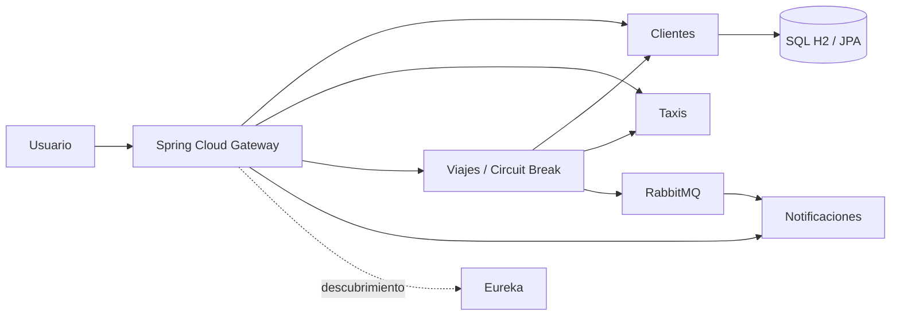

# Taxi Seguro: CI del listado de clientes

Proyecto académico de microservicios. El alcance de esta entrega de integración
continua es **un solo módulo: `services/clientes-service`**, especialmente el
endpoint `GET /api/clientes`. Los demás servicios forman parte del sistema,
pero no se construyen ni se prueban en esta tubería.

## Arquitectura



Clientes separa dominio, aplicación, infraestructura y presentación. El listado
recorre `ClientesHttp -> ListarClientesUseCase -> Clientes -> ClientesH2 -> ClienteJpa`.
Gateway utiliza nombres registrados en Eureka. Viajes valida clientes y reserva
taxis por comunicación síncrona; publica eventos para Notificaciones por RabbitMQ.
Cada servicio de negocio conserva su propia base de datos.

Esta entrega conserva Spring MVC y JPA en Clientes. No constituye una
implementación del caso hospitalario ni del requisito R2DBC del PDF completo.
El alcance adoptado es la aclaración de CI del listado de clientes.

## Requisitos y pruebas

- JDK 21. Maven Wrapper descarga Maven 3.9.12.
- Acceso a Maven Central para la primera descarga.
- Docker Compose solamente para ejecutar el sistema completo.

Desde la raíz, en Windows:

```powershell
.\mvnw.cmd -B -ntp -f services/clientes-service/pom.xml -DfailIfNoTests=true clean verify
```

En Linux:

```sh
sh ./mvnw -B -ntp -f services/clientes-service/pom.xml -DfailIfNoTests=true clean verify
```

Las cinco pruebas integran controlador, caso de uso y H2 en memoria: listado
vacío, listado con dos registros, persistencia y DNI duplicado, DNI inválido y
campos desconocidos. No requieren Eureka, RabbitMQ ni Docker.

## Ejecutar Clientes por separado

```powershell
$env:EUREKA_CLIENT_ENABLED='false'
.\mvnw.cmd -f services/clientes-service/pom.xml spring-boot:run
```

Consultar `http://localhost:8081/api/clientes`. Inicialmente devuelve `[]`.
Para registrar un cliente ficticio, enviar POST a la misma ruta:

```json
{"nombre":"Cliente ficticio","dni":"12345678","telefono":"999888777","email":"demo@example.com"}
```

El alta devuelve HTTP 201; el listado HTTP 200. Un DNI duplicado devuelve 409
y una petición inválida devuelve 400. La ejecución normal persiste en `data/`;
las pruebas usan una base temporal en memoria.

## Ejecutar el sistema completo

```sh
docker compose up --build -d
```

- Gateway: `http://localhost:8080/api/clientes`
- Eureka: `http://localhost:8761`
- RabbitMQ: `http://localhost:15672`

Las variables están descritas en `.env.example`. Usa una contraseña propia
mediante `RABBITMQ_PASSWORD`; `.env` queda excluido del repositorio. Los puertos
publicados por Compose se limitan a la máquina local.

## Integración continua

`.github/workflows/ci-clientes.yml` llama al workflow reutilizable Java para
construir solamente Clientes con Java 21. Se ejecuta en push de las ramas que
cambian el módulo y en PR hacia `main` con cambios relevantes, además de permitir
ejecución manual. Compila y luego ejecuta `verify`: pruebas, empaquetado y
validación. Un error produce estado rojo y evita generar el artefacto validado.
Los informes Surefire se conservan incluso tras un fallo; el JAR se guarda
solamente después del éxito. Las pruebas se ejecutan una sola vez.

Para impedir un merge defectuoso debe configurarse en GitHub una regla de rama
que exija el check de esta CI. El workflow por sí solo detecta errores, pero no
bloquea un merge manual. Los filtros por rutas deben considerarse al configurar
checks obligatorios.

Consulta [la guía de CI](docs/CI-CLIENTES.md) y
[el protocolo de demostración](docs/DEMOSTRACION-CI.md).

## Estado de la entrega

La configuración local no acredita una ejecución en la nube. Las evidencias
deben incluir enlaces a runs reales de GitHub Actions y a la PR de demostración:
éxito inicial, fallo controlado y corrección. El despliegue automático es opcional
y no forma parte de esta tubería.
