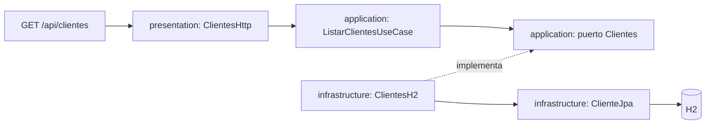

# Comparación y adaptación de la arquitectura

Referencia: `nexo-ecommerce-main.zip`, proporcionado el 11 de octubre de 2026.
Se comparó con la versión de Circuit Break que incluye CI para Clientes.

## Qué comparten ahora

| Aspecto | Nexo Ecommerce | Circuit Break adaptado |
|---|---|---|
| Repositorio | Módulos bajo `services/` | Módulos existentes bajo `services/` |
| Dominio | Entidades y excepciones | `domain/entities` y `domain/exceptions` en Clientes |
| Aplicación | Puertos y casos de uso | `application/ports` y `application/usecases` en Clientes |
| Infraestructura | Configuración y persistencia | `infrastructure/config` y `infrastructure/persistence` en Clientes |
| Presentación | Controladores y DTO | `presentation/controllers` y `presentation/dto` en Clientes |
| Listado | Casos de uso de lectura específicos | `ListarClientesUseCase` |
| CI | Workflow de servicio que llama a `reusable-java-ci.yml` | `ci-clientes.yml` llama al mismo patrón reutilizable |
| Documentación | `docs/` | Comparación y guía CI en `docs/` |

## Estructura resultante

```text
.github/workflows/
  ci-clientes.yml
  reusable-java-ci.yml
docs/
  CI-CLIENTES.md
  COMPARACION-NEXO.md
services/
  clientes-service/
    pom.xml
    src/main/java/org/taxi/clientes/
      Application.java
      domain/
        entities/Cliente.java
        exceptions/ErrorNegocio.java
      application/
        ports/Clientes.java
        usecases/GestionClientes.java
        usecases/ListarClientesUseCase.java
      infrastructure/
        config/CasosConfig.java
        persistence/ClienteFila.java
        persistence/ClienteJpa.java
        persistence/ClientesH2.java
      presentation/
        controllers/ClientesHttp.java
        controllers/ErroresHttp.java
        dto/ClienteRequest.java
    src/test/java/org/taxi/clientes/ClientesIntegrationTest.java
  eureka-server/
  api-gateway/
  taxis-service/
  CircuitBreak/
  notificaciones-service/
pom.xml
mvnw
mvnw.cmd
Dockerfile
compose.yaml
```

## Flujo del listado y dependencias



El controlador recibe la petición HTTP y llama al caso de uso de listado.
El caso de uso depende del puerto `Clientes`, no de Spring ni JPA.
`ClientesH2` implementa el puerto y traduce las filas persistidas al modelo
`Cliente` del dominio. Spring enlaza estas piezas mediante `CasosConfig`.
La infraestructura depende de las interfaces internas; dominio y aplicación
no importan controladores, infraestructura ni frameworks.

La solicitud de alta/edición se representa en `ClienteRequest`, separado del
controlador, manteniendo las validaciones existentes. El listado conserva su
JSON y ruta pública. No se requiere un DTO de respuesta adicional para cambiar
la estructura porque `Cliente` ya es un record con los campos públicos de la API.

## Cambios concretos

- Traslado de las carpetas de servicios a `services/`, sin cambiar su contenido
  funcional salvo el módulo Clientes.
- Actualización de rutas en el agregador Maven y Dockerfile. Compose conserva
  los nombres de servicios y los argumentos MODULE; el Dockerfile resuelve esos
  nombres dentro de `services/`.
- Reorganización de paquetes e imports de Clientes y su prueba.
- Extracción del DTO y del caso de uso de listado.
- CI por servicio y workflow Java reutilizable; solamente Clientes lo invoca.
- Guía de CI actualizada para la nueva ubicación.

Nexo contiene también un frontend Angular, PostgreSQL, Redis, pagos y pruebas
con Testcontainers. Esos componentes resuelven necesidades de ecommerce;
no se incorporaron a Taxi Seguro. Se conserva H2 para Clientes.
Los otros servicios conservan sus capas internas existentes.

## Ajustes respecto de los workflows de referencia

Los workflows Auth y Catalog del ZIP filtran rutas como `services/auth`, sin
`/**`; la versión adaptada usa `services/clientes-service/**` para incluir los
archivos del módulo. También responde a push, PR y ejecución manual, como exige
la tarea. Usa el wrapper de la raíz con `-f` al POM de Clientes, porque este
proyecto comparte ese wrapper. Se preservan las etapas y los informes de CI.

## Estado de validación

Consulta `VALIDACION-NEXO.md` para el resultado local. La ejecución en GitHub
Actions queda pendiente de acceso a la cuenta y publicación del repositorio.
